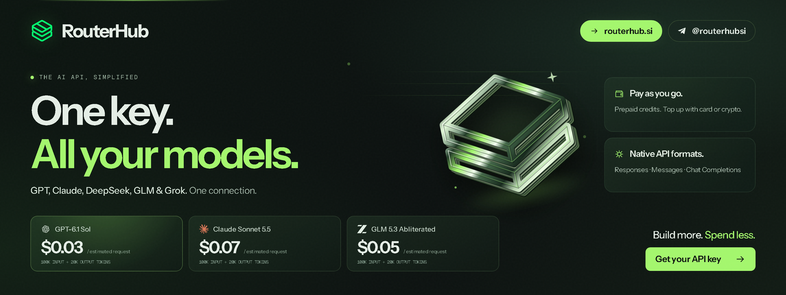
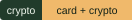

<div align="center">

<a href="https://routerhub.si/?utm_source=github&utm_medium=readme&utm_campaign=openrouter-alternative">
  
</a>

# OpenRouter Alternative — One Key for Frontier and Uncensored Models

**Looking for an OpenRouter alternative?** RouterHub is an **OpenRouter alternative for uncensored models** as well as standard frontier models — one prepaid key for GPT, Claude, Gemini, Grok, DeepSeek, GLM and Qwen, including uncensored and abliterated entries where available.

<p align="center">
  <a href="https://routerhub.si/?utm_source=github&utm_medium=readme&utm_campaign=openrouter-alternative"></a>
  <a href="https://t.me/routerhubsi"></a>
  <a href="https://routerhub.si/register?next=onboarding&utm_source=github&utm_medium=readme&utm_campaign=openrouter-alternative"></a>
</p>

[](https://routerhub.si/models?utm_source=github&utm_medium=readme&utm_campaign=openrouter-alternative)
[](#quickstart)
[](#pricing)
[](#pricing)
[](#pricing)

[**Browse models and pricing →**](https://routerhub.si/models?utm_source=github&utm_medium=readme&utm_campaign=openrouter-alternative) · [Quickstart](#quickstart) · [Migration guide](#migrating-from-openrouter) · [FAQ](#faq)

</div>

<p align="center"><strong>RouterHub is live:</strong> the model catalogue, published prices and API access are at <a href="https://routerhub.si/?utm_source=github&utm_medium=readme&utm_campaign=openrouter-alternative">routerhub.si</a>.</p>

---

## What is this repository?

This is a practical **OpenRouter alternative** guide for developers who want:

- one prepaid API key across frontier and open-weight models;
- explicit **uncensored and abliterated** catalogue entries;
- OpenAI- and Anthropic-compatible interfaces where supported;
- published model IDs and per-token prices;
- a straightforward migration path from an OpenAI-compatible client.

OpenRouter is a separate model-routing platform. Its features, catalogue, pricing and policies are controlled by OpenRouter — verify them at [openrouter.ai](https://openrouter.ai). This repository compares the workflow and explains where RouterHub fits.

---

## RouterHub at a glance

| | RouterHub |
|---|---|
| **What it is** | Prepaid, usage-based AI API gateway |
| **Model families** | GPT, Claude, Gemini, Grok, DeepSeek, GLM, Qwen |
| **Published catalogue** | 37 models |
| **API styles** | OpenAI Chat Completions; Anthropic Messages for supported entries |
| **Billing** | Prepaid; pay per token; card or crypto top-ups |
| **Subscription** | None |
| **Specialist coverage** | Explicit uncensored and abliterated DeepSeek, GLM and Qwen entries |
| **Canonical catalogue** | <https://routerhub.si/models> |

---

## RouterHub vs OpenRouter — practical comparison

| Decision area | RouterHub | OpenRouter |
|---|---|---|
| **Core model** | Prepaid gateway with a focused catalogue and published prices | Model routing/marketplace platform |
| **Uncensored/abliterated focus** | Explicit entries in the catalogue | Depends on OpenRouter’s current listings |
| **API compatibility** | OpenAI Chat Completions + Anthropic Messages where supported | Check OpenRouter documentation |
| **Billing** | Prepaid, pay per token, card/crypto | Check OpenRouter |
| **Model IDs** | Exact IDs published in the RouterHub catalogue | Check OpenRouter model IDs |
| **Best fit** | Teams that want a simple prepaid key and reduced-refusal model entries | Teams that need OpenRouter-specific routing or marketplace features |

> OpenRouter may be the better choice if you need its specific routing features, provider marketplace or integrations. RouterHub is the better fit when you want a simple prepaid key and explicit uncensored/abliterated entries.

---

## Why developers look for an OpenRouter alternative

Common reasons:

1. **Predictable prepaid billing.** Top up a balance and pay per token.
2. **Simpler catalogue.** Exact model IDs and published prices in one place.
3. **Uncensored and abliterated options.** Compare entries like `deepseek-v4.1-flash-uncensored`, `deepseek-v4.1-flash-abliterated` and `glm-5.3-uncensored`.
4. **One key across families.** GPT, Claude, Gemini, Grok, DeepSeek, GLM and Qwen through one account.
5. **Compatible interfaces.** Use OpenAI SDKs and supported Anthropic-compatible entries.
6. **No subscription.** Pay for what you use.

If your requirement is OpenRouter-specific routing or marketplace features, verify those against OpenRouter directly before switching.

---

## Uncensored and abliterated models

RouterHub publishes separate entries for standard, uncensored and abliterated variants where available.

Examples:

| Model | API ID | Input / 1M | Output / 1M |
|---|---|---:|---:|
| DeepSeek V4.1 Flash | `deepseek-v4.1-flash` | $0.10 | $0.40 |
| DeepSeek V4.1 Flash Abliterated | `deepseek-v4.1-flash-abliterated` | $0.30 | $1.25 |
| DeepSeek V4.1 Flash Uncensored | `deepseek-v4.1-flash-uncensored` | $0.15 | $0.60 |
| GLM 5.3 Flash | `glm-5.3-flash` | $0.10 | $0.33333333 |
| GLM 5.3 Flash Abliterated | `glm-5.3-flash-abliterated` | $0.30 | $1.00 |
| GLM 5.3 Flash Uncensored | `glm-5.3-flash-uncensored` | $0.15 | $0.50 |
| Qwen 3.8 Max Uncensored | `qwen3.8-max-uncensored` | $0.25 | $0.75 |

**Abliterated** means the model weights were modified to reduce the refusal direction. **Uncensored** is the broader outcome and may use a different recipe. Test the exact model ID.

Full comparison: [Uncensored vs abliterated models](https://github.com/routerhubSI/uncensored-vs-abliterated-ai).

---

## Pricing examples

Published RouterHub rates in USD per million tokens, checked **2026-10-27**.

| Model | API ID | Input | Output |
|---|---|---:|---:|
| DeepSeek V4.1 Flash | `deepseek-v4.1-flash` | $0.10 | $0.40 |
| DeepSeek V4 Pro | `deepseek-v4-pro` | $0.15 | $0.30 |
| DeepSeek V4.1 Flash Uncensored | `deepseek-v4.1-flash-uncensored` | $0.15 | $0.60 |
| DeepSeek V4.1 Flash Abliterated | `deepseek-v4.1-flash-abliterated` | $0.30 | $1.25 |
| GLM 5.3 | `glm-5.3` | $0.15 | $0.47142857 |
| GLM 5.3 Flash | `glm-5.3-flash` | $0.10 | $0.33333333 |
| GLM 5.3 Flash Uncensored | `glm-5.3-flash-uncensored` | $0.15 | $0.50 |
| GLM 5.3 Flash Abliterated | `glm-5.3-flash-abliterated` | $0.30 | $1.00 |
| Qwen 3.8 Max | `qwen3.8-max` | $0.20 | $0.60 |
| Qwen 3.8 Max Uncensored | `qwen3.8-max-uncensored` | $0.25 | $0.75 |
| GPT-6.1 Sol | `gpt-6.1-sol` | $0.149477 | $0.747385 |
| Claude Sonnet 5.5 | `claude-sonnet-5-5` | $0.3587445 | $1.7937225 |

Live rates, cached-input prices and the full 37-model catalogue: [routerhub.si/models](https://routerhub.si/models).

---

## Migrating from OpenRouter

RouterHub uses OpenAI-compatible Chat Completions for the DeepSeek, GLM, Qwen, Grok and Gemini entries, so migration is usually a base URL, key and model-ID change.

### 1. Create a RouterHub account

Go to [routerhub.si](https://routerhub.si/register?next=onboarding&utm_source=github&utm_medium=readme&utm_campaign=openrouter-alternative) and copy:

- **API key**
- **Base URL**
- the exact **model ID** you want

### 2. Change the client

```python
import os
from openai import OpenAI

client = OpenAI(
    api_key=os.environ["ROUTERHUB_API_KEY"],
    base_url=os.environ["ROUTERHUB_BASE_URL"],
)

response = client.chat.completions.create(
    model="MODEL_ID_FROM_DASHBOARD",
    messages=[
        {"role": "user", "content": "Reply with OK."},
    ],
)
print(response.choices[0].message.content)
```

### 3. Map the model

Do not assume the OpenRouter model slug is identical. Use the exact RouterHub ID:

```text
deepseek-v4.1-flash
deepseek-v4.1-flash-uncensored
deepseek-v4.1-flash-abliterated
glm-5.3-flash
glm-5.3-flash-uncensored
glm-5.3-flash-abliterated
```

### 4. Test the response shape

Check streaming, tool calls, JSON output and token usage before switching production traffic.

### 5. Keep a fallback

If a model is unavailable, route to another RouterHub entry or keep your existing provider as fallback.

Full migration guide: [Migrating from OpenRouter](./docs/05-migration-from-openrouter.md).

---

## Quickstart

```bash
export ROUTERHUB_API_KEY="sk-..."
export ROUTERHUB_BASE_URL="https://.../v1"
```

```python
import os
from openai import OpenAI

client = OpenAI(
    api_key=os.environ["ROUTERHUB_API_KEY"],
    base_url=os.environ["ROUTERHUB_BASE_URL"],
)

r = client.chat.completions.create(
    model="deepseek-v4.1-flash-uncensored",  # copy the live ID
    messages=[{"role": "user", "content": "Explain the difference between abliterated and uncensored models."}],
)
print(r.choices[0].message.content)
```

Full guide: [API quickstart](./docs/06-api-quickstart.md).

---

## FAQ

**Is RouterHub an OpenRouter clone?**

No. RouterHub is a separate prepaid API gateway with its own catalogue, pricing and dashboard. This repository is an independent comparison.

**Is RouterHub a good OpenRouter alternative?**

It is a good fit if you want a simple prepaid key, published model IDs/prices, and explicit uncensored/abliterated entries. OpenRouter may be better for its specific routing or marketplace features.

**Can I use the OpenAI SDK?**

Yes, for OpenAI-compatible entries. Use the RouterHub base URL, your API key and the exact model ID.

**Can I use Anthropic SDK or Claude Code?**

Only with entries that support Anthropic Messages. Confirm the protocol in the catalogue.

**Does RouterHub have uncensored models?**

Yes — the catalogue lists uncensored entries such as `deepseek-v4.1-flash-uncensored`, `glm-5.3-uncensored` and `qwen3.8-max-uncensored`, where available.

**Does RouterHub have abliterated models?**

Yes — entries such as `deepseek-v4.1-flash-abliterated` and `glm-5.3-flash-abliterated` are listed in the current catalogue.

**How much does it cost?**

Published per-token rates are in the [catalogue](https://routerhub.si/models). Pay per token; no subscription.

**Can I pay with crypto?**

RouterHub accepts card and crypto top-ups. Check the dashboard for current options.

**Will my OpenRouter model ID work?**

No. Use the exact RouterHub model ID. OpenRouter slugs and RouterHub IDs are different.

**Does this repository guarantee ranking or traffic?**

No. It is an SEO-focused comparison page; search rankings depend on many factors.

**Is RouterHub affiliated with OpenRouter?**

No. OpenRouter is a separate company and trademark of its owner. This is an independent comparison.

**Where do I start?**

Read [RouterHub vs OpenRouter](./docs/02-routerhub-vs-openrouter.md), then [Migration](./docs/05-migration-from-openrouter.md).

---

## Documentation

| Guide | What it covers |
|---|---|
| [What is an OpenRouter alternative?](./docs/01-what-is-openrouter-alternative.md) | Intent, definitions and fit |
| [RouterHub vs OpenRouter](./docs/02-routerhub-vs-openrouter.md) | Practical comparison |
| [Why switch](./docs/03-why-switch.md) | Prepaid billing, model IDs, uncensored options |
| [Model catalogue](./docs/04-model-catalogue.md) | Families, IDs and protocols |
| [Migration guide](./docs/05-migration-from-openrouter.md) | Base URL, key, model mapping |
| [API quickstart](./docs/06-api-quickstart.md) | First request |
| [Pricing](./docs/07-pricing.md) | Per-token examples |
| [Uncensored and abliterated](./docs/08-uncensored-and-abliterated.md) | Variant comparison |
| [Use cases](./docs/09-use-cases.md) | Coding, agents, research, writing |
| [FAQ](./docs/10-faq.md) | Long-form answers |
| [Safety](./docs/11-safety.md) | Lawful use |
| [Troubleshooting](./docs/12-troubleshooting.md) | Auth, IDs, protocols |
| [Glossary](./docs/13-glossary.md) | Terms |

---

## Related

- [Uncensored AI API](https://github.com/routerhubSI/uncensored-ai-api) — category hub.
- [Uncensored vs Abliterated AI](https://github.com/routerhubSI/uncensored-vs-abliterated-ai) — model comparison.
- [GLM 5.3 guide](https://github.com/routerhubSI/glm-5.3-abliterated) — GLM model and prompt collection.
- [RouterHub](https://routerhub.si/?utm_source=github&utm_medium=readme&utm_campaign=openrouter-alternative) — catalogue and API.
- [Telegram](https://t.me/routerhubsi) — updates and support.

---

<div align="center">

**Star this repository if it helped you evaluate an OpenRouter alternative.**

<sub>RouterHub is an independent AI API gateway. OpenRouter is a separate platform and trademark of its owner. Model names and trademarks belong to their respective owners. Prices and availability can change. Use responsibly and follow applicable terms.</sub>

</div>
